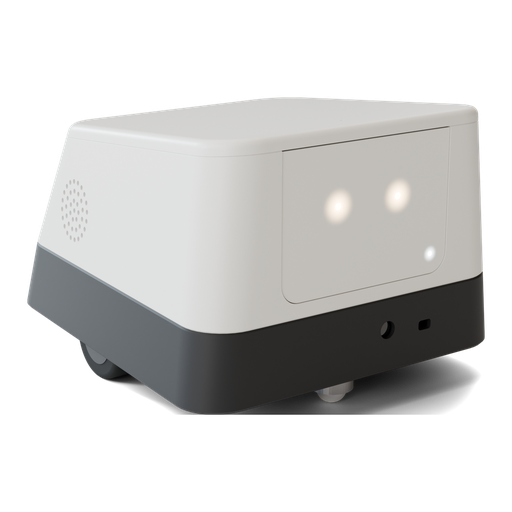
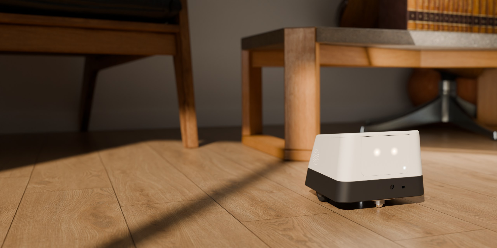

<p align="center">
  
</p>

<h1 align="center">Mirae</h1>

<p align="center">
  <b>Simple body. Intelligent behavior.</b><br>
  A small, open and hackable AI companion robot built around a Raspberry Pi 5.
</p>

<p align="center">
  <a href="https://github.com/Reterics/Mirae/actions/workflows/ci.yml"></a>
  <a href="https://reterics.github.io/Mirae/"></a>
  
  
</p>

<p align="center">
  
</p>

<p align="center"><sub>Rendered from the exact printable model in <a href="cad/README.md"><code>cad/</code></a>; no AI image generation.</sub></p>

<p align="center">
  <a href="https://reterics.github.io/Mirae/"></a>
  <a href="cad/stl/"></a>
  <a href="docs/hestore_20261022.xml"></a>
</p>

<p align="center"><sub>Five parts, each fits a 220 × 220 bed · Shopping cart: HESTORE cart export (XML), about 22 600 Ft net, see <a href="docs/hardware.md#shopping-list">the full parts list</a></sub></p>

---

## Meet Mirae

Mirae is a two-wheeled companion that lives on your floor. It sees you, hears you and answers you, but it doesn't try to look human. There's no mouth, no ears and no cartoon face: just a soft rounded body, two diffused light points for eyes, and a front panel that can later become a screen.

Its personality comes from software rather than mechanics. Computer vision, speech recognition and a pluggable AI layer run on a Raspberry Pi 5. The body around them is fully 3D-printable on an ordinary 220 × 220 printer.

> 🚧 **Status: early prototype.** Hardware selection, drivetrain prototyping and the enclosure design are in progress. The software skeleton runs in simulation; the Pi hardware drivers are written but not yet tested on the robot.

## Features (planned)

- **Sees**: person and object detection and tracking with Camera Module 3 NoIR and OpenCV
- **Hears and speaks**: Whisper speech recognition and text-to-speech over I2S audio
- **Moves safely**: differential drive with encoders and ToF obstacle avoidance
- **Thinks**: a provider-independent AI layer (Ollama, local models or remote APIs) that emits high-level intents
- **Works offline**: core movement and safety never depend on the cloud or the AI backend
- **Controllable**: a local FastAPI interface for control, telemetry and debugging

## Design

| | |
|---|---|
| **Size** | 190 × 210 × 145 mm, about 1 kg |
| **Body** | Warm-white upper shell over a charcoal base. Soft radii, sloped top and back. |
| **Face** | Two diffused LED eyes and a status light, on a removable front panel that's ready for a 2–3.5" display |
| **Stance** | Wheels sit just behind centre and a ball caster sits far forward, making a wide, stable triangle |
| **Access** | Lid held by hidden rear hooks and front magnets: lift the front to open. Built-in battery, charged over USB-C. Every part prints in one piece without supports. |

Ready-to-print STL files, print settings and assembly instructions are in [cad/README.md](cad/README.md). CAD authoring files and media generation tools are maintained privately; this repository contains the files used to build, install and run Mirae and publish its website.

## Quick start (no robot needed)

Needs Python 3.11+ and [uv](https://docs.astral.sh/uv/). Works on Windows, macOS and Linux:

```bash
uv sync
uv run mirae run          # simulated robot, API docs at http://127.0.0.1:8000/docs
uv run pytest
```

Deploying to the Pi 5, the API and the safety rules are covered in [docs/software.md](docs/software.md). The pin map is in [docs/wiring.md](docs/wiring.md).

## Hardware

| Subsystem | Component |
|---|---|
| Compute | Raspberry Pi 5 with a passive cooling case, optional AI HAT+ 2 (40 TOPS) under it |
| Drive | 2× N20 geared motors with encoders, 42 mm wheels, TB6612FNG driver, ball caster |
| Distance | VL53L1X Time-of-Flight sensor |
| Audio | INMP441 I2S microphone, MAX98357 amplifier, 4 Ω / 3 W speaker |
| Power | 4× 18650 Li-ion (2S2P) with BMS, SZ-08CV 5.1 V supply, XL6009-UD 6 V motor supply, USB-C charging |
| Vision | Raspberry Pi Camera Module 3 NoIR (Sony IMX708, 12 MP) |

Apart from the camera, the Raspberry Pi 5, its cooling case and the VL53L1X, the parts cost about **22 600 Ft (net)**. The full shopping list with part numbers is in [docs/hardware.md](docs/hardware.md#shopping-list).

## How it works

```text
Sensors ──► Vision / Speech ──► AI (LLM) ──► Behavior Engine ──► Safety ──► Motors
```

The LLM never drives the motors directly. It produces high-level intents such as `approach_person`, and a deterministic behavior engine turns them into safe movements. See [docs/architecture.md](docs/architecture.md).

## Repository

| Path | Contents |
|---|---|
| [`src/mirae/`](src/mirae/) | Robot software: HAL, safety governor, drive, behavior, AI, vision, speech, API |
| [`tests/`](tests/) | pytest suite, runs against simulated hardware |
| [`deploy/`](deploy/) | Raspberry Pi install script, systemd unit, boot config |
| [`cad/`](cad/README.md) | Ready-to-print STLs, enclosure preview and assembly instructions |
| [`docs/`](docs/) | Architecture, software, wiring, hardware and roadmap |
| [`assets/brand/`](assets/brand/) | Logo, favicons, hero and social preview images |
| [`site/`](site/) | Website publishing source and prebuilt production media |

Production media attribution is recorded in [assets/CREDITS.md](assets/CREDITS.md).

## Roadmap

| Version | Focus |
|---|---|
| V0.1 | Movement: GPIO, motor driver, basic REST API |
| V0.2 | Sensors: ToF, obstacle stop, encoders, odometry |
| V0.3 | Vision: camera streaming, person detection and tracking |
| V0.4 | Voice: microphone, speaker, Whisper, TTS |
| V0.5 | AI: LLM abstraction, Ollama, behavior engine |
| V0.6 | Autonomy: exploration, following, personality states |
| V1.0 | Complete robot: final enclosure, battery, reproducible build |

The full checklist is in [docs/roadmap.md](docs/roadmap.md).

## Design principles

- **Simple mechanics, software-first**: capability comes from code, not expensive hardware.
- **Modular**: every major subsystem can be replaced on its own.
- **Local-first, AI optional**: movement and safety work without a network or a model.
- **Hackable**: easy to modify, extend and experiment with.
