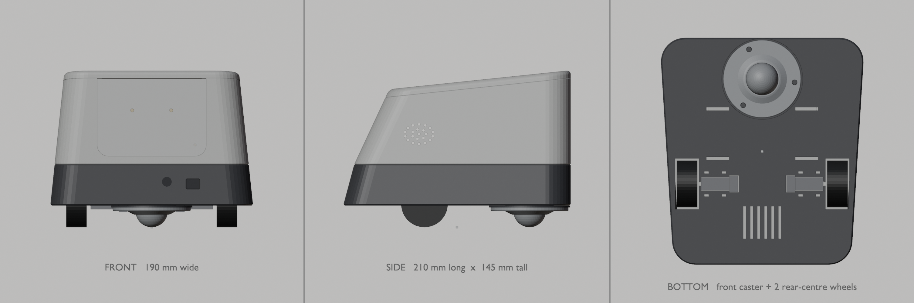

# Mirae enclosure: printing and assembly

Download the six ready-to-print files from [stl/](stl/). Dimensions are in
millimetres; use the print orientations and material guidance below.

The repository includes printable exports and assembly instructions. CAD source
files, modelling tools, and render generators are maintained privately.

## Design (v3)

Mirae v3 is a low, elongated, rounded-trapezoid body:

- **Size:** 190 mm wide × 210 mm long × 145 mm tall.
- **Two-tone shell:** a wider charcoal base under a warm-white upper shell.
- **Shape:** the side walls lean in slightly as they rise. The back slopes strongly and the top slopes down toward the rear, which gives the trapezoid side profile.
- **Drive layout:**
  - Two N20-driven wheels sit 30 mm behind the centre, recessed into the base so about 46% of each wheel shows.
  - One ball transfer unit (GG-KUB-30-B, Ø30 ball) sits far forward.
  - Together they form a support triangle with a 139 mm track and a 97 mm wheelbase.
- **Front:**
  - a blank, removable, screen-ready faceplate with two diffused LED points and an off-axis status light
  - the camera and ToF sensor in the charcoal base, to the right of centre

## Parts (all fit a 220 × 220 bed in one piece)

| STL | Print size (mm) | Colour | Print orientation |
|---|---|---|---|
| `chassis.stl` | 187 × 210 × 38 | charcoal | floor on the bed |
| `pi-module.stl` | 179 × 199 × 82 | white | tray floor on the bed |
| `top-cover.stl` | 163 × 173 × 17 | white | top face on the bed (the skirt, hooks and magnet bosses point up) |
| `faceplate.stl` | 108 × 75 × 4.4 | white / light grey | flange on the bed, front face up |
| `sensor-mount.stl` | 104 × 34 × 9.7 | black | front on the bed |
| `caster-spacer.stl` | 75 × 75 × 1.7 | charcoal | flat, either face on the bed |

## Hardware

Real sizes, sources and status for every part are in [`docs/parts.md`](../docs/parts.md). What the model reserves:

| Item | Envelope in the model |
|---|---|
| Ball caster | GG-KUB-30-B ball transfer unit, ball down: Ø71.8 × 3.3 flange, Ø45.06 cup 16.7 deep through a Ø46 floor hole, Ø30 ball 15 mm beyond the flange face, 3 × Ø5 holes on a Ø60 bolt circle. Screwed under the floor through the 1.7 mm `caster-spacer` into 3 M4 heat-set inserts |
| Wheels | N20-3PI-WHL: 42 × 18 mm, modelled as a 43 × 19 envelope |
| Motors | N20E-12-100 encoder motor: 26 × 12 × 10 mm, 3 mm shaft, plus a 15 × 15 × 8 encoder envelope |
| Motor driver | TB6612FNG-M: 20.5 × 20.5 mm, held in a slide-in pocket between the motors |
| Pi 5 + cooler or case | 91 × 65 × 34 mm reserve (fits e.g. the JOY-IT RB-AlucaseP5-09) on 4 × 15 mm M2.5 spacers (RI M2,5x15 BB) over the AI HAT+ 2 space, 58 × 49 holes. The reserve is centred on the board, 10 mm toward the USB side of the holes |
| AI HAT+ 2 (optional) | 65 × 56.5 mm board on the 3 mm tray standoffs under the Pi, heatsink 64 × 42.5 × 3.2 with 2 push pins, PCIe FFC in a 180° loop on the Pi's −X side. The space is reserved with or without the HAT |
| Battery | Spot-welded 2S2P pack of 4 × 18650, two rows of two cells end to end: 142 × 41 × 21 mm (conservative until a cell holder is measured), in a floor cradle, held by two 20 mm hook-and-loop straps |
| BMS | HX-2S-JH20: 50 × 27 × 6 mm reserve, flat on top of the pack |
| 5.1 V supply | SZ-08CV: 63 × 54 × 23 mm reserve (with airflow) on 4 × 7 mm M3 standoffs, holes 45 × 37, rear bay, floor vents underneath |
| Power switch | SL 19123 slide switch: 12.8 × 6.7 × 6.7 mm body in a pocket behind the rear wall, slider through a slot |
| USB-C charger | USBC-2S-LI-BOOST: temporary 35 × 22 × 6 mm on rails at the rear wall, USB-C through a 13 × 8 slot. MEASURE |
| 12 V motor supply | XL6009-UD: 49 × 24 × 13 mm on two 4 mm standoffs (M2.5 self-tapping, measured holes), front corner on the switch side |
| Motor capacitor | 1000 µF / 16 V (Ø10 × 13 mm) in a Ø10.5 × 17.5 mm space, lying behind the battery between the driver pocket and the switch-side encoder |
| Speaker 4 Ω / 3 W | 3525 box speaker: 35 × 25 × 6.5 mm in a slide-in slot behind an oval grille |
| MAX98357 | 19 × 17 × 5 mm, on the tray. MEASURE |
| INMP441 | 14 × 14 × 3 mm, under the lid's mic port. MEASURE |
| Camera Module 3 | 25 × 24 mm PCB, 10 mm lens housing |
| VL53L1X | Adafruit #3967: 25.4 × 17.8 mm board stood upright on 4 standoffs (holes 12.7 × 20.32) |

Check the dimensions of the parts you received against these envelopes before assembly.

The Pi reserve is sized for the largest case considered, the Joy-IT
[RB-AlucaseP5-09](https://joy-it.net/en/products/RB-AlucaseP5-09) (91 × 65 × 34 mm), and passes
the interference check; any cooler or case within it fits. See the [part dimensions](../docs/parts.md)
for verified nominal sizes and remaining measurements.

## Stance and stability

- **Caster height:** the base underside is at 20 mm. The GG-KUB-30-B's ball reaches 18.3 mm below the back of its flange, and the 1.7 mm spacer between the flange and the floor makes up the rest. The flange's real sheet thickness is still to be measured (3.3 mm is the drawing's overall flange height). The 43 mm wheel puts the axle at 21.5 mm, so each motor hangs 3.5 mm below the floor through an opening.
- **Motor mount:** the load goes through the gearbox boss into an open-top U slot in each motor plate. The vendor wheel is 42 mm, which tilts the body by about 0.3°.
- **Centre of mass:** about 1,730 g in total, 36 mm ahead of the axle and 60 mm above the ground. The caster carries 37% of the weight and the wheels 63%. The masses are listed in the [mass budget](../docs/parts.md#mass-budget); the printed parts are still estimated from their volume.
- **Why the axle sits 30 mm behind centre:** the SZ-08CV and its heatsinks weigh 0.22 kg and sit in the rear bay, behind the axle. With the axle 15 mm behind centre, the caster carried only 19%. Moving the axle back to 30 mm restores the load on the caster without moving weight into the Pi's upper shell.
- **Pulling away up a slope:** only the wheels push, so hard acceleration can lift the caster (nose up about the axle). On a 15% slope, facing uphill, that takes about 108 mN·m per motor. Holding still there takes 27 mN·m, and the N20E-12-100 is rated at 196 mN·m (HESTORE, at 12 V). The motors' stall torque isn't published, so the drive software also limits how fast the wheel commands can rise (`safety.ramp_per_s`).
- **Checked by the build:** the lift torque must be at least 1.5 × the rated torque, and the caster must carry 20–40% of the weight. Facing down a 15% slope, the wheels need a grip of 0.28 to hold the robot.
- **Battery position:** the pack lies flat on the base floor between the caster and the axle, as far back as the motor plates allow, so the caster's cup (which rises 12 mm above the floor) and insert bosses stay clear of it. It's fixed: a low cradle locates it and two straps through the floor hold it down.

## Face module interface

The V1 blank faceplate and any future 2–3.5" OLED/LCD face module share one interface: a **top-open slide-in slot** in the `pi-module`.

| Feature | Value |
|---|---|
| Visible panel | 100 mm wide, R10 bottom corners, 2.1 mm thick. From Z = 66 mm up to the lid, set 0.4 mm behind the front face |
| Retaining flange | 108 mm wide, R14, 2.3 mm thick. From Z = 62 mm |
| Rail frame opening | 92 mm wide, from Z = 70 mm |
| Max module envelope | 86 × 57 mm, 15 mm deep behind the faceplate |
| Fit | 0.35 mm per side. The lid holds the module down |

Removing it needs no tools: take the lid off and pull the faceplate up.

The LEDs glow through a 0.6 mm front skin, which needs white or light filament. For light pipes instead, set `led_skin = 0`.

## Access

| What | How to reach it |
|---|---|
| Lid | Lift the front (two hidden magnet pairs let go), swing it up about its rear edge until the two hidden rear hooks leave their keepers, then lift it away. A continuous skirt under the lid locates it; the magnets only hold it down. The build script checks the swing to 40° for collisions. |
| Pi, speaker, amp, faceplate | Lid off |
| Battery | Built in and not replaceable; charge it through the rear USB-C port. |
| Caster | From below: 3 × M4 through the flange and the spacer into heat-set inserts |
| Base electronics (battery, power modules, driver, motors) | Undo 4 M3 screws in the tray floor and lift the upper shell. The screwdriver path for each screw is checked clear. |

## PLA and PETG compatibility

Every part prints without supports in PLA or PETG with a 0.4 mm nozzle and 0.2 mm layers. The script's overhang check confirms nothing overhangs by more than 45° in print orientation, with one exception: the lid prints top-down, so its 4 mm edge fillet starts as a short overhang at the first layers (about 1.2 mm of it is steeper than 45°). Use a brim and print it slowly.

The only flat ceilings are:
- the lid groove, about 1.9 mm wide, bridged
- a 0.3 mm lip step on the upper shell
- the tops of the rear USB-C slot and the ToF window, 13 mm bridges
- small round holes

Rules built into the geometry:

- **Walls lean inward as they rise:** 6° on the sides, 15–25° at the back. Every surface stays printable from the bed up.
- **The front panel slot is open at the top,** so the front wall has no bridged window.
- **Bed edges are chamfered;** fillets are only on the top of the lid.
- **Fits:** 0.35 mm per side. Heat-set inserts use Ø4.2 holes for M3 and Ø5.6 for M4.
- **Heat:** PETG is recommended for `pi-module` because of the warm Pi 5. The other parts are fine in either material.

Print a small fit test first to tune `clearance` for your printer.

## Assembly order

The illustrated, step-by-step version is the site's `/assembly/` page (`site/src/assembly/steps.tsx`); keep the two in the same order.

1. **Prepare**
   1. Print the six parts.
   2. Solder the loose headers: TB6612FNG-M, MAX98357-M (plus its screw terminal), VL53L1X. Solder wires straight to the INMP441-M instead (only 3 mm is reserved under the lid).
   3. Spot-weld the 2S2P pack and connect the BMS.
   4. Set the SZ-08CV to 5.1 V and the XL6009-UD to 12.0 V with a multimeter, before any load.
   5. Press the heat-set inserts into the base: 4 × M3 for the join, 4 × M3 for the SZ-08CV standoffs, 3 × M4 for the caster.
2. **Base**
   1. Press each wheel onto its motor.
   2. Lower each motor and wheel unit into its motor plate's U slot, then zip-tie it.
   3. Slide the driver into its pocket.
   4. Lay the battery pack in its cradle and strap it down; the BMS sits on top of it.
   5. Screw the SZ-08CV to its standoffs.
   6. Place the XL6009-UD and the capacitor.
   7. Set the USB-C charger on its rails.
   8. Slide the power switch into its pocket behind the rear wall.
   9. Fit the camera (4 × M2 × 6) and the VL53L1X (4 × M2.5 × 6) to the sensor mount, then slide it into the front slot.
   10. Fit the caster from below: the spacer against the floor, then the caster, ball down, with 3 × M4 screws (length to be chosen once the flange's sheet thickness is measured).
   11. Wire the base (see `docs/wiring.md`).
3. **Upper shell:** if you have the AI HAT+ 2, set it on the standoffs and plug its PCIe ribbon in. Screw the four 15 mm spacers on from under the tray (4 × M2.5 × 10), fit the Pi on them and connect the ribbon to it, slide in the speaker and place the amp. Bring the camera ribbon up through the FPC slot and the base wiring through the cable slots.
4. **Close up**
   1. Screw the upper shell to the base with 4 × M3 from inside.
   2. Slide the faceplate in. (The LEDs for its eye and status lights aren't chosen yet.)
   3. Glue the mic under the lid.
   4. Glue a 5 × 2 mm magnet into each front column and into each boss under the lid (check the polarity so the pairs attract).
   5. Hold the lid with its front raised, hook the rear into the keepers, then lower the front until the magnets close.
