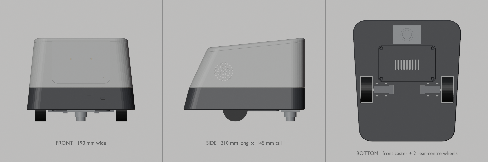

# Mirae enclosure (CAD)

The enclosure is generated by `blender/build_mirae.py`, a parametric script run inside Blender (through Blender MCP or the Text Editor):

```python
exec(open(r"D:/git/Mirae/cad/blender/build_mirae.py").read())
```

One run does the whole pipeline:

1. Builds every part.
2. Runs these checks, and only exports if the gated ones pass:

   | Check | What it tests | Gates export? |
   |---|---|---|
   | Manifold | No open or broken mesh edges on any part | Yes |
   | Interference | Every part against every reference component, including screw heads and screwdriver paths | Yes |
   | Bed fit | Every part fits a 220 × 220 bed in its print orientation | Yes |
   | Centre of mass | The CoM sits inside the three-wheel support triangle | Yes |
   | Overhangs | Reported for review | No |

3. Exports the STLs to `stl/`.
4. Saves `blender/robot.blend`.

Options:
- Pass `EXPORT=False` in the exec globals to only rebuild.
- Pass `RENDER=True` to also render the three views to `renders/`. All three come from one pass on the same geometry, at the same orthographic scale.

Units: 1 Blender unit = 1 mm. STLs are exported in mm.



## Design (v3)

Mirae v3 is a low, elongated, rounded-trapezoid body:

- **Size:** 190 mm wide × 210 mm long × 145 mm tall.
- **Two-tone shell:** a wider charcoal base under a warm-white upper shell.
- **Shape:** the side walls lean in slightly as they rise. The back slopes strongly and the top slopes down toward the rear, which gives the trapezoid side profile.
- **Drive layout:**
  - Two N20-driven wheels sit 15 mm behind the centre, recessed into the base so about 46% of each wheel shows.
  - One ball caster sits far forward.
  - Together they form a support triangle with a 141 mm track and a 95 mm wheelbase.
- **Front:**
  - a blank, removable, screen-ready faceplate with two diffused LED points and an off-axis status light
  - the camera and ToF sensor in the charcoal base, to the right of centre

## Parts (all fit a 220 × 220 bed in one piece)

| STL | Print size (mm) | Colour | Print orientation |
|---|---|---|---|
| `chassis.stl` | 187 × 210 × 38 | charcoal | floor on the bed |
| `battery-door.stl` | 99 × 63 × 2.5 | charcoal | outer face on the bed |
| `pi-module.stl` | 179 × 199 × 82 | white | tray floor on the bed |
| `top-cover.stl` | 163 × 172 × 7 | white | sloped underside flat on the bed |
| `faceplate.stl` | 108 × 75 × 4.4 | white / light grey | flange on the bed, front face up |
| `sensor-mount.stl` | 104 × 34 × 9.7 | black | front on the bed |

## Hardware

| Item | Spec used | Source |
|---|---|---|
| Ball caster | BCASTER-15-10K: 48.3 × 32.5 × 20 mm, Ø15.9 ball, 2 × M4 holes 39 mm apart | HESTORE |
| Wheels | N20-3PI-WHL: listed 42 × 18 mm rubber, modelled as a 43 × 19 envelope | HESTORE |
| Motors | N20E encoder motor: 26 × 12 × 10 mm, 3 mm shaft, plus a 15 × 15 × 8 encoder envelope | HESTORE, encoder MEASURE |
| Motor driver | TB6612FNG-M: 20.5 × 20.5 mm, held in a slide-in pocket between the motors | HESTORE |
| Pi 5 + passive case | 94 × 63 × 25 envelope on 3 mm standoffs (58 × 49 holes) | MEASURE |
| Battery | 2×18650 holder, 77 × 41 × 21 mm | MEASURE |
| 5 V / 5 A buck + charger/BMS | 60 × 35 × 15 envelope on 4 standoffs, rear of the base | MEASURE |
| Speaker 4 Ω / 3 W | Ø40 × 5 mm frame, 22 mm magnet | MEASURE |
| MAX98357 | 19 × 17 × 5 mm, on the tray | MEASURE |
| INMP441 | 14 × 14 × 3 mm, under the lid's mic port | MEASURE |
| Camera Module 3 | 25 × 24 mm PCB, 10 mm lens housing | |
| VL53L1X | 18 × 13 mm board | MEASURE |

All of these are in the interference check, so changing a value in `P` and re-running shows any collision.

## Stance and stability

- **Caster height:** the caster is 20 mm tall, which fixes the base underside at 20 mm. The 43 mm wheel puts the axle at 21.5 mm, so each motor hangs 3.5 mm below the floor through an opening.
- **Motor mount:** the load goes through the gearbox boss into an open-top U slot in each motor plate. The vendor wheel is 42 mm, which tilts the body by about 0.3°.
- **Centre of mass:** estimated at about 980 g total, sitting 11 mm ahead of centre. That leaves 26 mm to the nearest tipping edge.
- **Battery position:** the battery sits between the caster and the axle, so the robot can't tip backward. It loads from below through `battery-door`, which is held by 4 × M3 countersunk screws into heat-set inserts.

## Face module interface

The V1 blank faceplate and any future 2–3.5" OLED/LCD face module share one interface: a **top-open slide-in slot** in the `pi-module`.

| Feature | Value |
|---|---|
| Visible panel | 100 mm wide, R10 bottom corners, 2.1 mm thick. From Z = 66 mm up to the lid, set 0.4 mm behind the front face |
| Retaining flange | 108 mm wide, R14, 2.3 mm thick. From Z = 62 mm |
| Rail frame opening | 92 mm wide, from Z = 70 mm |
| Max module envelope | 86 × 57 mm, 15 mm deep behind the faceplate |
| Fit | 0.35 mm per side. The lid holds the module down |

Removing it needs no tools: lift the lid (it's held by magnets) and pull the faceplate up.

The LEDs glow through a 0.6 mm front skin, which needs white or light filament. For light pipes instead, set `led_skin = 0`.

## Access

| What | How to reach it |
|---|---|
| Lid | Lifts off. Held by 8 × 6×3 mm magnets on leaning corner columns, located by a lip and groove. |
| Pi, speaker, amp, faceplate | Lid off |
| Battery | From below: undo 4 screws and drop the door |
| Caster | From below: 2 × M4 into heat-set inserts |
| Base electronics (driver, power board, motors) | Undo 4 M3 screws in the tray floor and lift the upper shell. The screwdriver path for each screw is checked clear. |

## PLA and PETG compatibility

Every part prints without supports in PLA or PETG with a 0.4 mm nozzle and 0.2 mm layers. The script's overhang check confirms nothing overhangs by more than 45° in print orientation.

The only flat ceilings are:
- the lid groove, about 1.9 mm wide, bridged
- a 0.3 mm lip step on the upper shell
- small round holes

Rules built into the geometry:

- **Walls lean inward as they rise:** 6° on the sides, 15–25° at the back. Every surface stays printable from the bed up.
- **The front panel slot is open at the top,** so the front wall has no bridged window.
- **Bed edges are chamfered;** fillets are only on the top of the lid.
- **Fits:** 0.35 mm per side. Heat-set inserts use Ø4.2 holes for M3 and Ø5.6 for M4.
- **Heat:** PETG is recommended for `pi-module` because of the warm Pi 5. The other parts are fine in either material.

Print a small fit test first to tune `clearance` for your printer.

## Assembly order

1. **Base**
   1. Press the heat-set inserts into the base.
   2. Press each wheel onto its motor.
   3. Lower each motor and wheel unit into its motor plate's U slot, then zip-tie it.
   4. Slide the driver into its pocket.
   5. Screw the power board to its standoffs.
   6. Slide the sensor mount into the front slot.
   7. Fit the caster from below.
2. **Upper shell:** fit the Pi on its standoffs, slide in the speaker and place the amp. Route the camera ribbon through the FPC slot.
3. **Join:** screw the upper shell to the base with 4 × M3 from inside.
4. **Faceplate:** fit the LEDs, then slide the faceplate in. Glue the mic under the lid, then put the lid on.
5. **Battery:** fit the battery and close the door from below.
